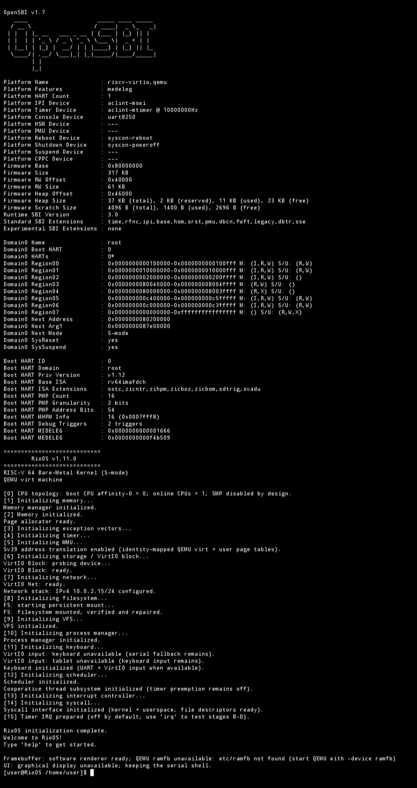

# RioOS — RISC-V64

<p align="center">
  <strong>RioOS — RISC-V64 Bare-Metal Operating System</strong><br>
  Built around MyKernel and designed for QEMU <code>virt</code> with OpenSBI.
</p>

<p align="center">
  <a href="./docs/BUILD_AND_RUN.md">Build &amp; Run</a> ·
  <a href="./docs/ARCHITECTURE.md">Architecture</a> ·
  <a href="./docs/LEARN.md">Learning Guide</a> ·
  <a href="./docs/ROADMAP.md">Roadmap</a>
</p>

> Made in Indonesia. Built to be studied, improved, and shared.

This source tree is the **RISC-V64-only** port of RioOS. It is a freestanding C++17/assembly kernel, not a Linux application. The normal boot path opens directly to the UART command shell.


# RioOS Preview



*RioOS running on QEMU system aarch64*


## Quick start

Install Clang/Clang++, LLD, Python 3, `readelf`/`llvm-readelf`, `nm`/`llvm-nm`, and `qemu-system-riscv64` with OpenSBI support.

### Linux

```sh
bash linux/build.sh
bash linux/run.sh             # Shell in the current terminal
bash linux/run-terminal.sh    # Shell in a separate QEMU text-console window
```

### Termux on Android

```sh
bash termux/build.sh
bash termux/run.sh
bash termux/run-terminal.sh
```

The separate-window runner may require Termux:X11 and QEMU with SDL support.

### macOS

```sh
bash macos/build.sh
bash macos/run.sh
bash macos/run-terminal.sh
```

The separate-window runner uses QEMU's Cocoa backend by default. Install a Clang/LLVM toolchain with a RISC-V bare-metal target and LLD.

### Windows PowerShell

The Windows folder follows the reference layout with three `.ps1` entry points. The wrappers call the shared Bash implementation, so install Git for Windows (Git Bash) and ensure LLVM and `qemu-system-riscv64` are available on `PATH`.

```powershell
.\windows\build.ps1
.\windows\run.ps1
.\windows\run-terminal.ps1
```

## Build options

Pass `--clean` to remove generated kernel build outputs and recreate the filesystem image. Pass `--verbose` to show compiler and test commands, or `--run` to build and then start the shell in the current terminal.

```sh
bash linux/build.sh --clean
bash linux/build.sh --verbose
bash linux/build.sh --run
```

The generated kernel is `build/riscv64/kernel.elf`; the generated filesystem image is `storage/disk.img`.

## Source layout

```text
README.md
linux/       build.sh, run.sh, run-terminal.sh
termux/      build.sh, run.sh, run-terminal.sh
macos/       build.sh, run.sh, run-terminal.sh
windows/     build.ps1, run.ps1, run-terminal.ps1
arch/        RISC-V64 boot metadata, traps, MMU, timer, UART, and RTC support
boot/        RISC-V64 boot entry, trap entry, and linker script
drivers/     keyboard, VirtIO, storage, and network drivers
fs/          MyFS and VFS
include/     kernel interfaces
kernel/      shell, syscalls, diagnostics, and core logic
memory/      memory and page allocation
net/         networking stack
process/     process, ELF, scheduler, and thread support
userspace/   terminal init, nano, and calculator
storage/     persistent filesystem image location
tests/       host regression tests and release verification
docs/        architecture, development, and subsystem documentation
```

The build keeps shell features, terminal `nano` and `calc`, U-mode ELF loading/syscalls, MyFS/VFS, VirtIO block/network/input drivers, diagnostics, process/thread primitives, and non-graphical host regression tests. See [`docs/BUILD_AND_RUN.md`](./docs/BUILD_AND_RUN.md) for detailed requirements and troubleshooting.
